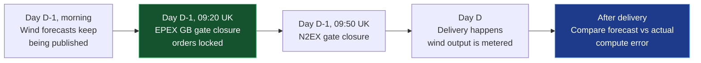
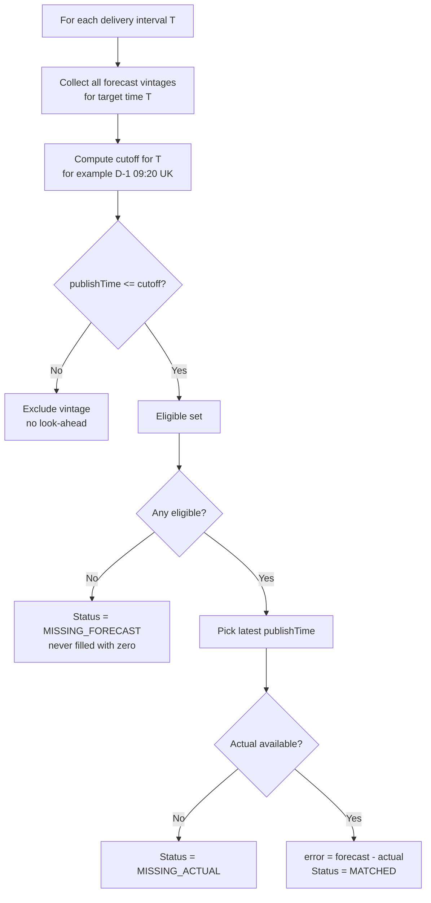
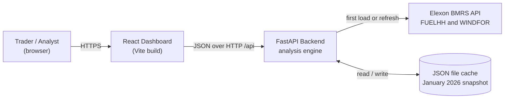
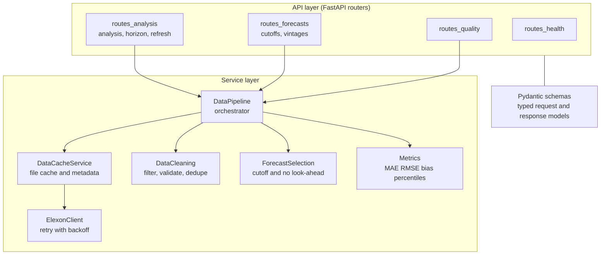
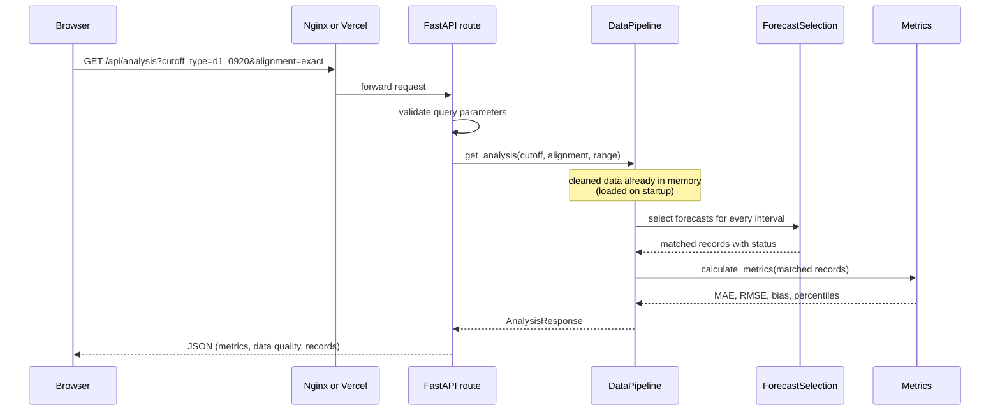
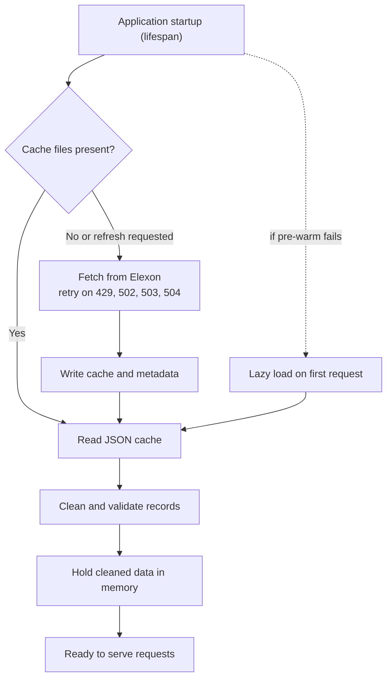
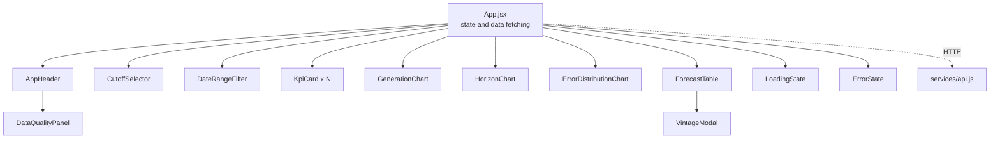
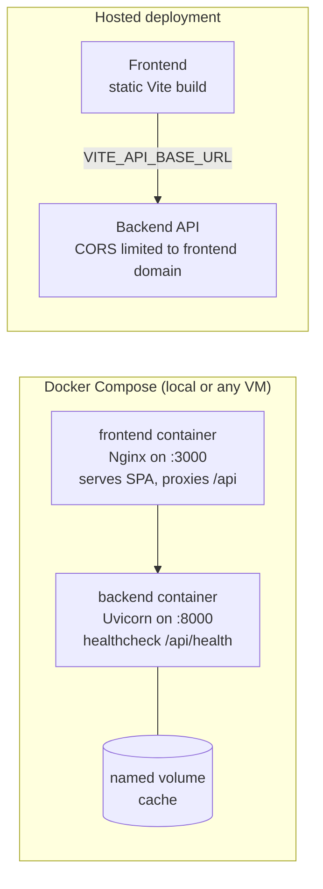
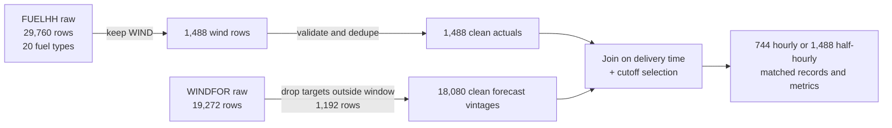

<div align="center">

# 🌬️ WindScope

### Day-Ahead Wind Forecast Intelligence for UK Power Buyers

**Know exactly which wind forecast you had when you had to buy, and exactly how wrong it was.**


### 🔗 [Live App](https://frontend-qwip.onrender.com) &nbsp;•&nbsp; 🎥 [Video Walkthrough](https://youtu.be/18QLa1RQG84) &nbsp;•&nbsp; 📘 [Methodology](docs/methodology.md) &nbsp;•&nbsp; 🏗️ [Architecture Notes](docs/architecture.md)

<br/>


</div>

---

## ⚡ At a Glance

- **1,488** half-hourly delivery intervals analysed (31 days of January 2026)
- **18,080** forecast versions (vintages) ingested from Elexon WINDFOR, including forecasts published in late December
- **8** selectable decision cutoffs, with the real **09:20 UK gate closure** as the default
- **0** look-ahead leaks: a forecast published after the cutoff can never be selected
- **9** error metrics: MAE, RMSE, bias, P50, P90, P95, normalised MAE, worst over-forecast, worst under-forecast
- **6** lead-time buckets showing how accuracy decays from 0 to 6 hours up to 48 hours and beyond
- **26** automated tests (23 backend, 3 frontend) plus a production build check
- **1** command to run everything: `docker-compose up --build`

---

## 📌 Table of Contents

1. [Executive Summary](#-executive-summary)
2. [Assignment Requirements Traceability Matrix](#-assignment-requirements-traceability-matrix)
3. [Screenshots and Interactive Demo](#-screenshots-and-interactive-demo)
4. [Key Findings: January 2026](#-key-findings-january-2026)
5. [Domain Background](#-domain-background)
6. [Methodology](#-methodology)
7. [Formula Reference](#-formula-reference)
8. [System Architecture](#-system-architecture)
9. [Data Model and Data Lineage](#-data-model-and-data-lineage)
10. [Architecture Decision Records](#-architecture-decision-records)
11. [Tech Stack](#-tech-stack)
12. [Repository Structure](#-repository-structure)
13. [Getting Started](#-getting-started)
14. [API Reference](#-api-reference)
15. [Testing and Verification](#-testing-and-verification)
16. [Deployment](#-deployment)
17. [Reliability, Security and Performance](#-reliability-security-and-performance)
18. [Assumptions, Limitations and Roadmap](#-assumptions-limitations-and-roadmap)
19. [Engineering Practices](#-engineering-practices)
20. [AI Tool Disclosure](#-ai-tool-disclosure)

---

## 🧭 Executive Summary

**The client** is a UK energy utility whose trading team buys power on the **day-ahead wholesale market**. Orders are locked on the day before delivery. Wind output is weather dependent, so the team must rely on wind forecasts to decide how much extra power (for example from thermal plants) it needs to buy.

**The two questions this product answers**

1. **Visibility:** *What was the latest wind forecast available at the moment I had to decide?*
2. **Accuracy:** *How accurate were such forecasts, in numbers, so I can build the error into my buying decision?*

**How WindScope answers them**

- It rebuilds the decision moment for every delivery half hour. Only forecasts published **on or before the cutoff** are eligible, and the **latest eligible** one is selected.
- It compares each selected forecast with the metered outturn and reports bias, error size, error tails and a suggested shortfall buffer.
- It shows how forecast quality changes with forecast age, so the team can see what waiting for a newer forecast would have bought them.
- It makes every number auditable: a data quality panel, a methodology panel, and a per-interval vintage inspector.

**The headline result for January 2026:** forecasts available at gate closure over-estimated wind by about **+1.85 GW on average** (MAE 2,127 MW, 18.4% of average output). Trusting them blindly would have left the buyer short of backup power in most hours.

---

## ✅ Assignment Requirements Traceability Matrix

Every requirement in the assignment brief is listed below with the implementation and the evidence that proves it.

### A. Functional and data requirements

| # | Requirement from the brief | Status | How it is implemented | Evidence |
|---|---|---|---|---|
| A1 | Web app for a UK energy utility buying on the day-ahead market | ✅ Done | Trading dashboard with cutoff selector, KPIs, charts, table | [`frontend/src/App.jsx`](frontend/src/App.jsx) |
| A2 | **Need 1:** clearly understand the latest forecasts available when decisions are made | ✅ Done | Latest-eligible-forecast selection per delivery interval, default cutoff at EPEX GB gate closure (09:20 UK), chart of actual vs selected forecast, vintage inspector | [`forecast_selection.py`](backend/app/services/forecast_selection.py), [`GenerationChart.jsx`](frontend/src/components/GenerationChart.jsx), [`VintageModal.jsx`](frontend/src/components/VintageModal.jsx) |
| A3 | **Need 2:** evaluate forecast accuracy quantitatively | ✅ Done | MAE, RMSE, bias, P50/P90/P95, nMAE, worst cases, shortfall buffer, error by lead time | [`metrics.py`](backend/app/services/metrics.py), [`test_metrics.py`](backend/tests/test_metrics.py) |
| A4 | Actuals from Elexon **FUELHH** | ✅ Done | Elexon client fetches the FUELHH stream | [`elexon.py`](backend/app/services/elexon.py) |
| A5 | Use only `fuelType == "WIND"` | ✅ Done | Cleaner filters to WIND (29,760 raw rows over 20 fuel types become 1,488 wind rows) | [`data_cleaning.py`](backend/app/services/data_cleaning.py), `test_clean_fuelhh_filters_wind_and_dates` |
| A6 | Use `startTime` (30 min resolution) and `generation` from actuals | ✅ Done | Delivery grid of 1,488 half hours, matched by `startTime` | `test_expected_intervals_january_2026` |
| A7 | Forecasts from Elexon **WINDFOR** | ✅ Done | Elexon client fetches the WINDFOR stream | [`elexon.py`](backend/app/services/elexon.py) |
| A8 | Use forecast `startTime`, `publishTime`, `generation` | ✅ Done | All three fields are kept and used for selection, lead time and error | [`schemas.py`](backend/app/models/schemas.py) |
| A9 | Only national-level Elexon wind data, no other data | ✅ Done | No external or additional data source is used | [`elexon.py`](backend/app/services/elexon.py) |
| A10 | Purchase decisions in **January 2026** only | ✅ Done | Delivery window fixed to 1 to 31 Jan 2026; forecasts published from 30 Dec 2025 are kept so early-January deliveries have eligible forecasts | `test_preserves_december_published_forecast`, `test_clean_windfor_filters_and_preserves_december_publishes` |
| A11 | Decisions happen one day before delivery | ✅ Done | D-1 cutoffs computed in the `Europe/London` timezone | `test_cutoff_calculation_d1_0920`, `test_d1_0920_eligibility_boundary` |
| A12 | Forecast made *before* the decision must be the one evaluated (no hindsight) | ✅ Done | `publishTime <= cutoff` filter, then latest wins | `test_forecast_selection_no_eligible_forecast` |

### B. Technical requirements

| # | Requirement | Status | Implementation | Evidence |
|---|---|---|---|---|
| B1 | React front end | ✅ Done | React 18 + Vite + Tailwind + Recharts | [`frontend/`](frontend) |
| B2 | Python back end | ✅ Done | FastAPI + Pydantic v2 | [`backend/`](backend) |
| B3 | Use Docker | ✅ Done | Dockerfile for each service plus `docker-compose.yml` with healthcheck | [`docker-compose.yml`](docker-compose.yml) |
| B4 | Deploy on Vercel or Heroku | ✅ Done | See the live link at the top of this README | [Deployment](#-deployment) |
| B5 | Mention AI tools in the README | ✅ Done | Disclosure section at the end | [AI Tool Disclosure](#-ai-tool-disclosure) |

### C. Deliverables

| # | Deliverable | Status | Where |
|---|---|---|---|
| C1 | Unlisted YouTube video, max 10 minutes | ✅ Done | [Video Walkthrough](PASTE_UNLISTED_YOUTUBE_URL) |
| C2 | Video part 1: customer pitch (max 5 min overview) | ✅ Done | First half of the video; talking points in [`docs/video_demo_script.md`](docs/video_demo_script.md) |
| C3 | Video part 2: tech lead walkthrough of architecture, design, analysis, code base and practices (max 5 min overview) | ✅ Done | Second half of the video; see [Architecture](#-system-architecture) and [Engineering Practices](#-engineering-practices) |
| C4 | Public GitHub repo with anonymous name | ✅ Done | This repository |
| C5 | README: files and directories | ✅ Done | [Repository Structure](#-repository-structure) |
| C6 | README: how to start the application | ✅ Done | [Getting Started](#-getting-started) |
| C7 | README: link to the deployed app | ✅ Done | Top of this README and [Deployment](#-deployment) |
| C8 | Submission form | ✅ Done | Submitted with all links verified in incognito mode |

### D. Beyond the brief (added value)

| # | Extra capability | Why it matters to the client |
|---|---|---|
| D1 | Error by forecast lead time (6 buckets) | Shows what waiting for a newer forecast would have gained |
| D2 | P90 and P95 error and a suggested shortfall buffer | Turns an average error into a number a buyer can size a hedge with |
| D3 | Eight selectable cutoffs including a "late" sensitivity case | Proves the conclusions are robust, and shows how a late cutoff flatters accuracy |
| D4 | Forecast vintage inspector | Lets a trader audit any single decision |
| D5 | Data quality and methodology panel | Every number is traceable to a formula and a record count |
| D6 | Two alignment modes (hourly vs half-hourly) | Handles the 60 min vs 30 min resolution mismatch openly |
| D7 | Cached data plus a refresh endpoint | Fast, reproducible, and resilient to upstream downtime |

---

## 🖼️ Screenshots and Interactive Demo

<p align="center">
  

</p>

<p align="center">
  

</p>

*Teal: actual outturn (FUELHH). Purple: forecast selected at the cutoff (WINDFOR). Orange bars: error = forecast minus actual. Bars above zero mean the forecast was too high.*


<p align="center">
  

</p>


<p align="center">
  

</p>


<p align="center">
  

</p>


<p align="center">
  

</p>


<p align="center">
  

</p>


---

## 📊 Key Findings: January 2026

Default cutoff: **day-ahead gate closure, 09:20 UK time**. Error is **forecast minus actual**.

### Headline accuracy

| Metric | Hourly (744 intervals) | Half-hourly mapping (1,488 intervals) |
|---|---|---|
| MAE | **2,127.48 MW** | 2,145.17 MW |
| RMSE | **2,606.07 MW** | 2,615.81 MW |
| Bias | **+1,851.53 MW** | +1,851.90 MW |
| Normalised MAE | **18.37%** of mean actual 11,581 MW | 18.52% |
| P50 absolute error | 1,758.50 MW | 1,795.50 MW |
| P90 absolute error | 4,306.40 MW | 4,274.90 MW |
| P95 absolute error | 5,350.90 MW | 5,340.95 MW |
| Over-forecast / under-forecast intervals | 631 / 113 | 1,263 / 225 |
| P95 under-forecast size (suggested shortfall buffer) | 2,374.00 MW | 2,333.40 MW |
| Worst over-forecast | +6,894 MW (12 Jan 01:00 UTC) | +6,894 MW |
| Worst under-forecast | -3,389 MW (8 Jan 19:00 UTC) | -3,835 MW (8 Jan 18:30 UTC) |

### What this means for the buyer

- **The bias is the story.** Forecasts were too high in 631 of 744 hours. Positive error means wind was over-estimated, so backup power was under-bought. Correcting for bias would be the single most valuable adjustment.
- **Tails matter more than the average.** The typical error is about 1.8 GW, but one hour in twenty is off by more than 5.3 GW.
- **Error grows with forecast age**, as the table below shows.

### Error by lead time (all forecast versions, hourly alignment)

| Lead time | MAE (MW) | RMSE (MW) | Bias (MW) | Samples |
|---|---|---|---|---|
| 0 to 6 h | 1,767.72 | 2,249.21 | +1,548.25 | 1,488 |
| 6 to 12 h | 1,833.73 | 2,304.38 | +1,616.10 | 1,488 |
| 12 to 24 h | 1,990.88 | 2,474.17 | +1,811.20 | 2,976 |
| 24 to 36 h | 2,122.56 | 2,586.87 | +1,838.48 | 2,976 |
| 36 to 48 h | 2,337.01 | 2,866.21 | +2,004.50 | 2,945 |
| 48 h and more | 2,371.92 | 2,977.90 | +1,479.56 | 2,510 |

### Sensitivity: how the choice of cutoff changes the conclusion

| Cutoff | MAE (MW) | Bias (MW) | Matched intervals |
|---|---|---|---|
| **Day-ahead 09:20 UK (default, real gate closure)** | **2,127.48** | **+1,851.53** | 744 |
| Day-ahead 09:00 UK | 2,127.48 | +1,851.53 | 744 |
| Day-ahead 12:00 UK (late) | 2,002.91 | +1,805.86 | 744 |
| Day-ahead 17:00 UK | 1,968.25 | +1,816.53 | 744 |
| 48 h before delivery | 2,379.89 | +1,879.26 | 589 (155 have no eligible forecast) |
| 24 h before delivery | 2,050.24 | +1,854.22 | 744 |
| 12 h before delivery | 1,897.54 | +1,703.99 | 744 |
| Latest before delivery | 1,794.22 | +1,592.49 | 744 |

**Reading the table**

- Using a **12:00 cutoff instead of the real 09:20 gate closure would understate the error by about 5.9%** (2,003 vs 2,127 MW), because it lets the analysis use forecasts a trader did not have. This is why the default is the realistic cutoff.
- 09:00 and 09:20 give identical results because no WINDFOR forecast was published between those two times in January 2026, so both cutoffs select the same forecasts.
- The positive bias (+1.6 to +1.9 GW) is present under **every** cutoff, so the finding is robust and not an artefact of the chosen time.

---

## 🌍 Domain Background

### The day-ahead timeline



Forecasts published **after** the green box are useless for the purchase decision, even though they are more accurate. A fair accuracy evaluation must ignore them. That is the core idea of this project.

### Glossary

- **Outturn / actual generation:** metered wind output, from FUELHH.
- **Forecast vintage:** one specific version of a forecast for a delivery time. The same delivery time can have many vintages published at different times.
- **Publish time:** when a forecast version was created.
- **Cutoff:** the latest publish time allowed for a forecast to count as "known at decision time".
- **Lead time:** delivery time minus publish time.
- **Settlement period:** UK half-hour slot numbered 1 to 48 per day.
- **Bias:** average signed error. Positive means over-forecast.
- **Gate closure:** the deadline after which an auction accepts no more orders.

---

## 🧠 Methodology

### Forecast selection



### Worked example (real data)

Delivery time: **15 Jan 2026, 12:00 UTC**, cutoff **14 Jan 2026, 09:20 UTC**.

- 24 forecast versions exist for this delivery time.
- 11 were published on or before the cutoff and are eligible.
- The latest eligible one was published **14 Jan 07:30 UTC** (lead time 28.5 h) and predicted **11,049 MW**.
- The next version, published 14 Jan 09:30 UTC (11,178 MW), came **after** the cutoff and is excluded.
- Actual outturn was **9,742 MW**, so the error is **+1,307 MW** (over-forecast).

### Decision cutoffs

- `d1_0920` **(default)**: 09:20 UK time on D-1, the EPEX GB day-ahead gate closure
- `d1_0900`: 09:00 UK time on D-1
- `d1_1200`: 12:00 UK time on D-1, a late sensitivity case after the real gate closure
- `d1_1700`: 17:00 UK time on D-1
- `lead_12h`, `lead_24h`, `lead_48h`: fixed lead time before each delivery interval
- `latest`: newest forecast published before delivery starts

D-1 cutoffs are built in the `Europe/London` timezone and converted to UTC, so they stay correct in summer time too.

### Metrics

```
error  = forecast - actual                 (MW)
MAE    = mean(|error|)
RMSE   = sqrt(mean(error^2))
Bias   = mean(error)
nMAE   = MAE / mean(actual) x 100          (%)
P50, P90, P95 = percentiles of |error|     (linear interpolation)
Shortfall buffer = P95 of |error| over under-forecast intervals only
```

- **Positive error:** over-forecast. Wind was lower than predicted and thermal power was under-procured.
- **Negative error:** under-forecast. Wind was higher than predicted and thermal power was over-procured.
- Metrics use **only matched intervals**. Missing values are never converted to zero.
- The complete, formal version of every formula is in the [Formula Reference](#-formula-reference).

### Resolution alignment

FUELHH is half-hourly and WINDFOR is hourly.

- **Exact:** evaluate only the hours where both datasets have a value (744 intervals).
- **Hourly block:** apply each hourly forecast to both half-hours of that hour (1,488 intervals).

### Data cleaning rules

- Keep only `fuelType == "WIND"`.
- Reject null, NaN and infinite generation values.
- Drop records whose target time is outside the analysis window.
- Deduplicate actuals by `startTime` and forecasts by `(startTime, publishTime)`.
- Normalise all timestamps to timezone-aware UTC.

---

## 📐 Formula Reference

Every formula used by the backend, and by the frontend where it calculates anything, in one place. Symbols: $F$ = forecast (MW), $A$ = actual (MW), $e$ = error, $n$ = number of matched intervals, $T$ = delivery time.

### 1. Delivery grid and settlement periods

$$N_{half} = 31 \text{ days} \times 48 = 1{,}488 \qquad N_{hour} = 31 \times 24 = 744$$

$$\text{SP}(T) = 2 \cdot \text{hour}(T) + \mathbb{1}[\text{minute}(T) \ge 30] + 1 \qquad (\text{SP} \in \{1,\dots,48\})$$

Example: 12:00 gives SP 25, and 23:30 gives SP 48.

### 2. Decision cutoff $C(T)$

Let $D$ be the UK local date of $T$.

$$C_{d1}(T) = \text{UTC}\big((D - 1\text{ day})\ \text{at}\ hh{:}mm\ \text{Europe/London}\big), \quad hh{:}mm \in \{09{:}20,\ 09{:}00,\ 12{:}00,\ 17{:}00\}$$

$$C_{lead\text{-}k}(T) = T - k\text{ hours}, \quad k \in \{12, 24, 48\} \qquad\qquad C_{latest}(T) = T$$

### 3. Forecast selection

Let $T'$ be the forecast target time: $T' = T$ in exact mode, and $T' = \lfloor T \rfloor_{hour}$ in hourly-block mode (a `:30` interval uses the forecast for the hour start).

$$\mathcal{E}(T) = \{\, f \in \text{WINDFOR} \;:\; f.\text{startTime} = T',\ \ f.\text{publishTime} \le C(T) \,\}$$

$$f^{*}(T) = \underset{f \in \mathcal{E}(T)}{\arg\max}\ f.\text{publishTime} \qquad \text{(no eligible } f \Rightarrow \text{MISSING\_FORECAST)}$$

### 4. Lead time

$$L(f, T) = \frac{T - f.\text{publishTime}}{3600\ \text{s}} \quad \text{(hours, rounded to 2 decimals)}$$

### 5. Interval error

$$e_T = F^{*}(T) - A(T) \qquad |e_T| = \big|F^{*}(T) - A(T)\big| \qquad \text{(rounded to 2 decimals)}$$

- $e > 0$: over-forecast (wind lower than predicted, thermal under-procured)
- $e < 0$: under-forecast (wind higher than predicted, thermal over-procured)
- Interval status: `MATCHED` if both $F$ and $A$ exist, otherwise `MISSING_FORECAST`, `MISSING_ACTUAL` or `MISSING_BOTH`. Only `MATCHED` intervals enter the metrics.

### 6. Accuracy metrics (over matched intervals)

$$\text{MAE} = \frac{1}{n}\sum_{i=1}^{n} |e_i| \qquad \text{RMSE} = \sqrt{\frac{1}{n}\sum_{i=1}^{n} e_i^{2}} \qquad \text{Bias} = \frac{1}{n}\sum_{i=1}^{n} e_i$$

$$\overline{A} = \frac{1}{n}\sum_{i=1}^{n} A_i \qquad\qquad \text{nMAE} = \frac{\text{MAE}}{\overline{A}} \times 100\%$$

### 7. Percentiles (linear interpolation, same as `numpy.percentile` default)

For sorted values $x_0 \le x_1 \le \dots \le x_{m-1}$ and percentile $p$:

$$r = \frac{p}{100}(m-1) \qquad w = r - \lfloor r \rfloor \qquad P_p = x_{\lfloor r \rfloor}\,(1-w) + x_{\lceil r \rceil}\,w$$

Used for P50, P90 and P95 of $|e|$.

### 8. Risk-sizing quantities

$$\text{Shortfall buffer} = P_{95}\big(\{\,|e_i| : e_i < 0\,\}\big) \qquad \text{Over-forecast boundary} = P_{95}\big(\{\,e_i : e_i > 0\,\}\big)$$

$$\text{Worst over-forecast} = \max_i e_i \ (\text{reported if} > 0) \qquad \text{Worst under-forecast} = \min_i e_i \ (\text{reported if} < 0)$$

### 9. Direction counts

$$\text{over} = \#\{e_i > 0.001\} \qquad \text{under} = \#\{e_i < -0.001\} \qquad \text{exact} = n - \text{over} - \text{under}$$

### 10. Data quality percentages (over the evaluated intervals $N_{eval}$)

$$\text{Actual completeness} = \Big(1 - \frac{N_{missing\ actual}}{N_{eval}}\Big) \times 100 \qquad \text{Forecast completeness} = \Big(1 - \frac{N_{missing\ forecast}}{N_{eval}}\Big) \times 100$$

$$\text{Matched completeness} = \frac{N_{matched}}{N_{eval}} \times 100 \qquad \text{(each rounded to 1 decimal)}$$

### 11. Lead-time horizon analysis

Unlike sections 3 to 6, this uses **every** forecast version $f$ with a known actual, not only the selected one.

$$e_f = F_f - A(T), \qquad L_f = \frac{T - f.\text{publishTime}}{3600}, \qquad \text{keep only } L_f \ge 0$$

Each pair is placed in the bucket whose range contains $L_f$ (lower bound inclusive, upper bound exclusive): $[0,6)$, $[6,12)$, $[12,24)$, $[24,36)$, $[36,48)$ and $[48,\infty)$ hours.

$$\text{MAE}_b = \frac{1}{n_b}\sum_{f \in b} |e_f| \qquad \text{RMSE}_b = \sqrt{\frac{1}{n_b}\sum_{f \in b} e_f^{2}} \qquad \text{Bias}_b = \frac{1}{n_b}\sum_{f \in b} e_f$$

Here $n_b$ is the number of forecast-and-actual pairs in bucket $b$ (the "Samples" column in the findings table).

### 12. Daily error chart (frontend)

For each calendar day $d$ with $n_d$ matched intervals:

$$\text{Bias}_d = \operatorname{round}\Big(\frac{1}{n_d}\sum e_i\Big) \qquad \text{MAE}_d = \operatorname{round}\Big(\frac{1}{n_d}\sum |e_i|\Big)$$

### 13. Derived figures quoted in this README

$$\text{Share over-forecast} = \frac{631}{744} \approx 84.8\%$$

$$\text{Understatement from a late cutoff} = \frac{\text{MAE}_{09:20} - \text{MAE}_{12:00}}{\text{MAE}_{09:20}} = \frac{2127.48 - 2002.91}{2127.48} \approx 5.9\%$$

Time-alignment check (Pearson correlation between actuals shifted by $k$ hours and forecasts):

$$r_k = \frac{\sum (A_i - \bar A)(F_{i-k} - \bar F)}{\sqrt{\sum (A_i - \bar A)^2}\ \sqrt{\sum (F_{i-k} - \bar F)^2}}$$

The correlation is highest at $k = 0$ ($r = 0.954$), confirming there is no timestamp offset.

### 14. Worked numeric check

Four matched intervals with $(A, F)$ = (100, 110), (200, 190), (150, 170), (150, 150) give $e = [+10, -10, +20, 0]$:

$$\text{MAE} = \frac{10+10+20+0}{4} = 10 \qquad \text{RMSE} = \sqrt{\frac{100+100+400+0}{4}} = \sqrt{150} \approx 12.25 \qquad \text{Bias} = \frac{10-10+20+0}{4} = 5$$

$$\overline{A} = 150 \qquad \text{nMAE} = \frac{10}{150} \times 100 \approx 6.67\% \qquad P_{50}(|e|) = P_{50}([0,10,10,20]) = 10$$

This exact dataset is asserted in `test_metrics_known_values`.

---

## 🏗️ System Architecture

### 1. System context



### 2. Backend components



### 3. Request lifecycle: `GET /api/analysis`



### 4. Startup and data loading



### 5. Frontend component tree



### 6. Deployment topologies



---

## 🗂️ Data Model and Data Lineage

### Source datasets

**FUELHH (actuals)**

- `startTime`: delivery time in UTC, 30 minute resolution
- `settlementDate`, `settlementPeriod`: UK settlement day and slot (1 to 48)
- `fuelType`: only `WIND` is used
- `generation`: metered output in MW
- `publishTime`: when the outturn record was published

**WINDFOR (forecasts)**

- `startTime`: delivery time being forecast (hourly)
- `publishTime`: when this forecast version was created
- `generation`: forecast output in MW

### Output record (one per delivery interval)

- `deliveryTime`, `settlementPeriod`
- `actualGeneration`, `forecastGeneration`
- `forecastPublishTime`, `leadHours`
- `error`, `absError`
- `status`: `MATCHED`, `MISSING_FORECAST`, `MISSING_ACTUAL` or `MISSING_BOTH`

### Lineage and record counts (January 2026 cache)



---

## 📐 Architecture Decision Records

| # | Decision | Alternatives considered | Why this choice | Trade-off |
|---|---|---|---|---|
| ADR-1 | **Default cutoff at the real GB gate closure (09:20 UK)** | 12:00 UTC, "latest forecast" | Matches when orders actually lock; avoids look-ahead bias that would flatter the forecasts by about 6% | Fewer forecast versions are eligible |
| ADR-2 | **Compute D-1 cutoffs in `Europe/London`, then convert to UTC** | Hard-coded UTC times | Stays correct across daylight saving changes | Needs timezone data (`tzdata`) |
| ADR-3 | **File cache instead of a database** | PostgreSQL, SQLite | Dataset is small and fixed (1,488 half hours); zero migrations; fully reproducible; instant responses | Not suited to continuous multi-month ingestion |
| ADR-4 | **Hold cleaned data in memory** | Query per request | Each analysis runs in memory over about 20,000 rows | Memory grows with data volume |
| ADR-5 | **Never impute missing values** | Fill with zero or interpolate | Zero would fake a huge error; missing data is shown explicitly | Some intervals are excluded from metrics |
| ADR-6 | **Two alignment modes** | Resample silently | The 30 min vs 60 min mismatch is made visible and the user can choose | Slightly more UI to explain |
| ADR-7 | **Selection logic in its own module with unit tests** | Inline in routes | The most important business rule is isolated, readable and testable | One more layer of indirection |
| ADR-8 | **FastAPI + Pydantic v2** | Flask, Django | Typed contracts, automatic OpenAPI docs, input validation | Async features are not heavily used |
| ADR-9 | **Nginx proxy in Docker, `VITE_API_BASE_URL` elsewhere** | Always cross-origin | Same-origin in containers means no CORS setup; configurable for separate hosting | Two configuration modes to document |
| ADR-10 | **Report percentiles and a shortfall buffer, not only MAE** | MAE and RMSE only | Buyers care about tail risk, not just the average | Extra concepts for non-technical readers |

---

## 🧰 Tech Stack

| Layer | Technology | Purpose |
|---|---|---|
| Frontend | React 18, Vite 5 | SPA and fast builds |
| Styling | Tailwind CSS 3 | Dark analytics theme |
| Charts | Recharts 2 | Interactive time series and bar charts |
| Icons | Lucide React | UI icons |
| Backend | Python 3.12, FastAPI | REST API |
| Validation | Pydantic v2, pydantic-settings | Typed schemas and env config |
| HTTP client | HTTPX | Elexon API calls with retries |
| Server | Uvicorn | ASGI server |
| Time handling | `zoneinfo`, `tzdata`, `python-dateutil` | UK timezone cutoffs |
| Testing | Pytest, Vitest, React Testing Library | Backend and frontend tests |
| Containers | Docker, Docker Compose, Nginx | Reproducible runtime |

---

## 📁 Repository Structure

```text
.
├── backend/
│   ├── app/
│   │   ├── main.py                    # App entrypoint, CORS, startup pre-warm
│   │   ├── config.py                  # Environment-driven settings
│   │   ├── api/
│   │   │   ├── routes_health.py       # GET  /api/health
│   │   │   ├── routes_analysis.py     # GET  /api/analysis, /api/analysis/horizon
│   │   │   │                          # POST /api/analysis/refresh
│   │   │   ├── routes_forecasts.py    # GET  /api/forecasts/cutoffs, /vintages
│   │   │   └── routes_quality.py      # GET  /api/data-quality
│   │   ├── models/schemas.py          # Pydantic request and response models
│   │   └── services/
│   │       ├── elexon.py              # Elexon BMRS client with retries
│   │       ├── data_cache.py          # JSON cache with metadata
│   │       ├── data_cleaning.py       # Filtering, validation, dedupe, interval grid
│   │       ├── forecast_selection.py  # Cutoffs and the no look-ahead rule
│   │       ├── metrics.py             # MAE, RMSE, bias, percentiles, extremes
│   │       └── data_pipeline.py       # Orchestration and horizon analysis
│   ├── data/cache/                    # Cached Jan 2026 FUELHH and WINDFOR data
│   ├── tests/                         # 23 pytest tests
│   ├── requirements.txt
│   └── Dockerfile
├── frontend/
│   ├── src/
│   │   ├── App.jsx                    # State, data fetching, layout
│   │   ├── App.test.jsx               # 3 Vitest tests
│   │   ├── services/api.js            # API client
│   │   └── components/                # Header, KPI cards, charts, table, modals
│   ├── nginx.conf                     # Serves SPA and proxies /api
│   ├── vite.config.js                 # Build chunking and test config
│   └── Dockerfile                     # Multi-stage build
├── docs/
│   ├── architecture.md
│   ├── methodology.md
│   ├── video_demo_script.md
│   └── screenshots/                   # Images used in this README
├── docker-compose.yml
├── pytest.ini
├── .env.example
└── README.md
```

---

## 🚀 Getting Started

### Option 1: Docker (recommended)

```bash
docker-compose up --build
```

- Dashboard: http://localhost:3000
- API: http://localhost:8000
- Interactive API docs: http://localhost:8000/docs
- Health check: http://localhost:8000/api/health

Stop with `docker-compose down`.

### Option 2: Run locally

**Backend**

```bash
cd backend
python -m venv .venv
source .venv/bin/activate          # Windows: .\.venv\Scripts\Activate.ps1
pip install -r requirements.txt
uvicorn app.main:app --host 0.0.0.0 --port 8000 --reload
```

**Frontend** (new terminal)

```bash
cd frontend
npm install
npm run dev
```

Open the URL printed by Vite (usually http://localhost:3000 or http://localhost:5173).

### Environment variables

Copy `.env.example` to `.env` to override defaults.

| Variable | Default | Meaning |
|---|---|---|
| `HOST` / `PORT` | `0.0.0.0` / `8000` | Backend bind address |
| `CORS_ORIGINS` | `*` | Comma-separated allowed origins for the API |
| `ELEXON_API_BASE_URL` | `https://data.elexon.co.uk/bmrs/api/v1` | Elexon API root |
| `DATA_CACHE_DIR` | `backend/data/cache` | Where cached JSON lives |
| `VITE_API_BASE_URL` | `http://localhost:8000` if unset | Backend URL for the frontend. Set to empty for same-origin `/api` paths |

---

## 🔌 API Reference

Interactive docs are served at `/docs` (Swagger UI) when the backend runs.

| Method | Endpoint | Purpose | Main query parameters |
|---|---|---|---|
| GET | `/api/health` | Liveness and version | none |
| GET | `/api/analysis` | Matched records, metrics and data quality | `cutoff_type`, `alignment`, `start_date`, `end_date` |
| GET | `/api/analysis/horizon` | Error metrics grouped by lead time | `alignment`, `start_date`, `end_date` |
| POST | `/api/analysis/refresh` | Re-fetch from Elexon and rebuild the cache | none |
| GET | `/api/forecasts/cutoffs` | Available decision cutoffs | none |
| GET | `/api/forecasts/vintages` | Every forecast published for one delivery time | `delivery_time`, `cutoff_type` |
| GET | `/api/data-quality` | Completeness and quality report | none |

### Example: one record from `GET /api/analysis`

```json
{
  "deliveryTime": "2026-01-15T12:00:00Z",
  "settlementPeriod": 25,
  "actualGeneration": 9742.0,
  "forecastGeneration": 11049.0,
  "forecastPublishTime": "2026-01-14T07:30:00Z",
  "leadHours": 28.5,
  "error": 1307.0,
  "absError": 1307.0,
  "status": "MATCHED"
}
```

---

## 🧪 Testing and Verification

### Quality gates

| Gate | Command | Result |
|---|---|---|
| Backend unit and API tests | `pytest -v` | **23 passed** |
| Frontend component tests | `cd frontend && npm test` | **3 passed** |
| Production build | `cd frontend && npm run build` | Builds successfully with vendor chunk splitting |

### Backend tests: what each one proves

| Area | Test | What it verifies |
|---|---|---|
| Metrics | `test_compute_percentile_linear` | Linear-interpolation percentiles are correct (P0, P25, P50, P75, P100 on a known list) |
| Metrics | `test_metrics_known_values` | MAE 10.0, RMSE 12.25, bias 5.0, nMAE 6.67%, P50 10.0 on a hand-calculated 4-point dataset |
| Metrics | `test_metrics_empty_records` | Empty input returns `None` values and no crash or divide-by-zero |
| Metrics | `test_metrics_ignores_unmatched_records` | Intervals with a missing forecast or actual do not enter the metrics |
| Metrics | `test_metrics_systematic_underforecast` | Negative bias and the under-forecast count are reported correctly |
| Data cleaning | `test_expected_intervals_january_2026` | Grid has exactly 1,488 intervals, starts at period 1 on 1 Jan 00:00 and ends at period 48 on 31 Jan 23:30 |
| Data cleaning | `test_clean_fuelhh_filters_wind_and_dates` | Non-wind fuels and out-of-range dates are dropped, valid wind rows are kept |
| Data cleaning | `test_clean_windfor_filters_and_preserves_december_publishes` | Duplicates are removed and forecasts published in December for January deliveries are kept |
| Selection | `test_cutoff_calculation_d1_0920` | Delivery on 15 Jan gives cutoff 14 Jan 09:20 |
| Selection | `test_cutoff_calculation_d1_1200` | Sensitivity cutoff is 14 Jan 12:00 |
| Selection | `test_cutoff_calculation_lead_24h` | Rolling cutoff is exactly 24 h before delivery |
| Selection | `test_cutoff_calculation_latest` | "Latest" cutoff equals the delivery time |
| Selection | `test_d1_0920_eligibility_boundary` | A forecast published at **09:19 is eligible** and one at **09:21 is excluded** |
| Selection | `test_forecast_selection_no_eligible_forecast` | When every forecast is after the cutoff the interval is `MISSING_FORECAST`, not zero |
| Selection | `test_preserves_december_published_forecast` | A forecast published on 31 Dec is eligible for a 1 Jan delivery |
| API | `test_health_endpoint` | `/api/health` returns status, version and timestamp |
| API | `test_cutoffs_endpoint` | `d1_0920` exists and is the only default; `d1_1200` exists as non-default |
| API | `test_analysis_endpoint_default_cutoff` | With no `cutoff_type` the API uses `d1_0920` and returns metrics, percentiles, quality and records |
| API | `test_analysis_endpoint_with_explicit_cutoff` | Explicit cutoff and date range return matched intervals |
| API | `test_horizon_endpoint` | Six buckets are returned and a controlled fixture gives the hand-calculated MAE, bias and sample counts per bucket |
| API | `test_vintages_endpoint` | Vintage endpoint returns the actual value and all forecast versions for one delivery time |
| API | `test_data_quality_endpoint` | Report states 1,488 expected intervals and includes the resolution notice |
| Health | `test_api_health_endpoint` | Health route responds correctly in its own test module |

### Frontend tests

| Test | What it verifies |
|---|---|
| `renders loading state initially` | A loading indicator shows before data arrives |
| `renders KPI cards and analysis when data loads` | KPI cards and the analysis view render from API data |
| `renders error state on API failure` | A failed request shows an error state instead of a blank page |

### Data validation checks you can reproduce

Run from the `backend` folder to confirm the analysis against independent calculations.

```bash
python - <<'EOF'
import sys; sys.path.insert(0, ".")
from statistics import correlation, mean
from app.services.data_pipeline import pipeline

# 1. Time alignment: correlation should peak at zero lag
r = pipeline.get_analysis(cutoff_type="latest", alignment="exact")
a = [x.actualGeneration for x in r.records]
f = [x.forecastGeneration for x in r.records]
for lag in (-2, -1, 0, 1, 2):
    xs, ys = (a[lag:], f[:len(f)-lag]) if lag >= 0 else (a[:lag], f[-lag:])
    print(f"lag {lag:+d}h  correlation {correlation(xs, ys):.4f}")

# 2. Independent recomputation of headline metrics
d = pipeline.get_analysis()
errs = [x.error for x in d.records if x.status == "MATCHED"]
print("MAE ", round(mean(abs(e) for e in errs), 2), "vs reported", d.metrics.mae)
print("Bias", round(mean(errs), 2), "vs reported", d.metrics.bias)
EOF
```

Expected output:

- Correlation is highest at **lag +0h (0.9540)**, which confirms actuals and forecasts are aligned in time with no offset.
- Recomputed MAE **2,127.48** and bias **+1,851.53** match the reported values exactly.

### Data integrity checks

| Check | Expected | Observed |
|---|---|---|
| Expected delivery intervals in January | 31 x 48 = 1,488 | 1,488 |
| Wind actuals retrieved | 1,488 | 1,488 (100% complete) |
| Invalid timestamps / invalid generation / duplicates in actuals | 0 | 0 / 0 / 0 |
| Matched intervals under the default cutoff (hourly alignment) | 744 | 744 |
| Missing forecasts under the default cutoff | 0 | 0 |
| Forecast rows outside the analysis window | dropped | 1,192 dropped, 18,080 kept |

### Manual verification checklist for reviewers

- [ ] Open the live app and confirm the dashboard loads with the default cutoff `Day-Ahead gate closure 09:20 UK`
- [ ] Change the cutoff to `Day-Ahead 12:00 UK` and confirm MAE drops from about 2,127 to about 2,003 MW
- [ ] Switch alignment to hourly block and confirm the interval count changes from 744 to 1,488
- [ ] Open the vintage inspector for 15 Jan 12:00 and confirm 24 versions, with the selected one published 14 Jan 07:30
- [ ] Open the data quality panel and confirm 1,488 expected intervals and 100% actual completeness
- [ ] Filter the table by `MISSING_FORECAST` using the 48 h cutoff and confirm 155 intervals appear
- [ ] Call `/docs` on the backend and try the endpoints

---

## ☁️ Deployment

**Live app:** PASTE_DEPLOYED_URL

<!-- Edit this section so it describes exactly what you deployed and where. -->

- **Frontend:** root directory `frontend`, framework preset Vite, build command `npm run build`, output directory `dist`, environment variable `VITE_API_BASE_URL` set to the backend URL.
- **Backend:** deploy the `backend` folder. Set `CORS_ORIGINS` to the frontend domain and `ELEXON_API_BASE_URL` to the value in the table above. Platforms that choose their own port (such as Heroku) must start Uvicorn on `$PORT`.
- **Data:** the January 2026 snapshot ships inside the image, so the app works with no outbound call at startup.

---

## 🛡️ Reliability, Security and Performance

**Reliability**

- Retries with increasing wait on Elexon `429`, `502`, `503` and `504` responses.
- Startup pre-warm of the data pipeline, with lazy loading on the first request if pre-warm fails.
- Docker healthcheck on `/api/health` and a frontend that waits for a healthy backend.
- Cached snapshot keeps the app working if Elexon is unavailable.

**Security**

- No secrets or API keys are required: the Elexon datasets used are public.
- CORS origins are configurable and should be restricted to the frontend domain in production.
- Query parameters are validated by FastAPI and Pydantic.
- No personal data is stored or processed.

**Performance**

- Cleaned data is held in memory, so each analysis request computes over roughly 20,000 records without touching disk or network.
- Vendor code is split into separate chunks and the larger modals are lazy loaded to keep the initial page light.
- Gzip is enabled in the Nginx configuration.

---

## ⚠️ Assumptions, Limitations and Roadmap

**Assumptions**

- Scope is national wind data from Elexon only, for decisions made in January 2026, exactly as the brief specifies.
- The decision moment is modelled as the EPEX GB gate closure (09:20 UK time). N2EX closes a little later (about 09:50), so 09:20 is the conservative choice. Other cutoffs are provided for comparison.

**Limitations**

- Forecasts are hourly while actuals are half-hourly, so two alignment modes are offered.
- Under the 48 h cutoff, 155 intervals spread across the month have no forecast published at least 48 hours ahead. They are reported as missing instead of being filled.
- Findings describe one winter month and should not be generalised to other seasons.
- The file cache suits a fixed dataset. Continuous ingestion would need a database.

**Roadmap**

- Extend to other months and seasons and compare error by season
- Add demand and price data to translate MW error into pounds of imbalance exposure
- Bias-corrected forecast as an optional view
- Probabilistic bands from the empirical error distribution
- Scheduled refresh job and a CI pipeline running tests and the build on every push
- Authentication and role-based access for a multi-team deployment

---

## 🧑‍💻 Engineering Practices

- **Separation of concerns:** routers, services, schemas and configuration live in separate modules.
- **Typed contracts:** every response is defined by a Pydantic model and documented automatically.
- **Business rule isolation:** the no look-ahead logic is one module with dedicated boundary tests.
- **Test strategy:** hand-calculated unit tests for formulas, boundary tests for time logic, fixture-based tests for endpoints, component tests for the UI.
- **Reproducibility:** pinned dependency ranges, lock file for the frontend, Docker images, cached data.
- **Configuration through environment variables** with a documented `.env.example`.
- **Documentation:** this README plus `docs/architecture.md`, `docs/methodology.md` and a recording script.
- **Defensive data handling:** invalid values rejected, duplicates removed, missing data shown explicitly.

---

## 🤖 AI Tool Disclosure

Google DeepMind **Antigravity** was used to assist with architecture planning, component scaffolding, test drafting and documentation. All code, formulas, data pipelines and tests were reviewed, run and verified by me, and the validation checks in this README can be reproduced with the commands shown above.

---

<div align="center">

Built for the REint Full Stack SWE challenge

</div>
