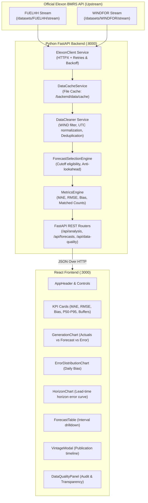

# WindScope — System Architecture Documentation

## 1. System Overview

**WindScope** is a full-stack UK wind power forecast intelligence and analysis platform designed for electricity trading and procurement teams participating in the UK Day-Ahead wholesale power market (e.g., EPEX SPOT and Nord Pool GB Day-Ahead auctions).

---

## 2. Component Specifications

### 2.1 Backend Architecture (`Python 3.12 + FastAPI`)

- **`ElexonClient` (`backend/app/services/elexon.py`)**:
  - Connects directly to verified BMRS endpoints:
    - `https://data.elexon.co.uk/bmrs/api/v1/datasets/FUELHH/stream`
    - `https://data.elexon.co.uk/bmrs/api/v1/datasets/WINDFOR/stream`
  - Utilizes `httpx` with bounded exponential retries (up to 3 retries) and 45-second read timeouts for high-volume data streams.
- **`DataCacheService` (`backend/app/services/data_cache.py`)**:
  - Persists retrieved Elexon payloads to `backend/data/cache/` (`fuelhh_jan2026.json`, `windfor_jan2026.json`) alongside `metadata.json`.
  - Ensures sub-second local response times and resilient offline/container startup.
  - Supports on-demand cache refresh via `POST /api/analysis/refresh`.
- **`DataCleaner` (`backend/app/services/data_cleaning.py`)**:
  - Filters `FUELHH` outturn to `fuelType == 'WIND'`.
  - Enforces timezone-aware UTC datetime parsing (`python-dateutil`).
  - Validates finite, non-null numeric power generation values.
  - Resolves duplicate records by latest publication timestamp.
  - Strictly isolates delivery intervals to January 2026 (`2026-01-01T00:00:00Z` to `2026-01-31T23:30:00Z`).
  - Preserves forecast records published in December 2025 for January 2026 deliveries.
- **`ForecastSelectionEngine` (`backend/app/services/forecast_selection.py`)**:
  - Applies configurable market decision cutoffs defaulting strictly to **Day-Ahead 09:20 UK time (EPEX SPOT GB auction gate closure)** computed in the `Europe/London` timezone (zoneinfo) and converted to UTC.
  - Eliminates look-ahead bias: strictly rejects forecasts published after the decision cutoff.
  - Retains alternative sensitivity cutoffs: Day-Ahead 09:00 UK, Day-Ahead 12:00 UK (late sensitivity case), Day-Ahead 17:00 UK, rolling lead times (12h, 24h, 48h), and gate closure (0h).
  - Selects `max(publishTime)` among eligible records for each target delivery interval.
  - Supports resolution alignment modes: `exact` (:00 hourly) and `hourly_block` (half-hourly mapped).
- **`MetricsEngine` (`backend/app/services/metrics.py`)**:
  - Computes `MAE`, `RMSE`, `Bias`, Normalised MAE (`nMAE %`), Error Percentiles (`P50`, `P90`, `P95`), Extreme errors, and Decision Buffers (P95 shortfall and over-forecast boundaries) strictly over valid matched delivery intervals.
  - Implements safe empty-dataset handling without division-by-zero errors.

---

### 2.2 Frontend Architecture (`React 18 + Vite + TailwindCSS + Recharts`)

- **State Management**:
  - Native React hooks (`useState`, `useEffect`, `useCallback`, `useMemo`).
  - Centralized API layer (`frontend/src/services/api.js`) communicating over HTTP.
- **Interactive Visualizations**:
  - Dual-axis `ComposedChart` rendering actual wind outturn (teal line), selected forecast (indigo line), and signed forecast error (amber bars).
  - Daily error distribution bar chart displaying day-by-day bias tendencies.
  - Dynamic interactive tooltips showing generation values, publication times, and lead times in hours.
- **User Controls**:
  - Decision cutoff selector with detailed policy explanations.
  - Date range quick-slice buttons (Full Month, Weeks 1-4, Late Jan) and custom calendar pickers.
  - Resolution selector toggling between exact hourly and half-hourly block views.
- **Data Transparency & Auditing**:
  - Dedicated Data Transparency modal detailing delivery interval accounting, missing intervals, and mathematical formulas.
  - Forecast Vintage Inspector modal showing the full historical publication timeline for any selected interval.

---

## 3. Docker Containerization

- **Multi-Stage Frontend Build**:
  - Stage 1: Compiles React assets using Node 20.
  - Stage 2: Packages static bundle into lightweight `nginx:alpine` image.
  - Reverse proxy routes `/api/` traffic directly to the backend service.
- **Backend Service**:
  - `python:3.12-slim` with multi-worker Uvicorn and built-in Docker health check.
- **`docker-compose.yml`**:
  - Orchestrates both services on an isolated bridge network (`windscope-network`).
  - Frontend accessible on `http://localhost:3000`.
  - Backend accessible on `http://localhost:8000`.
